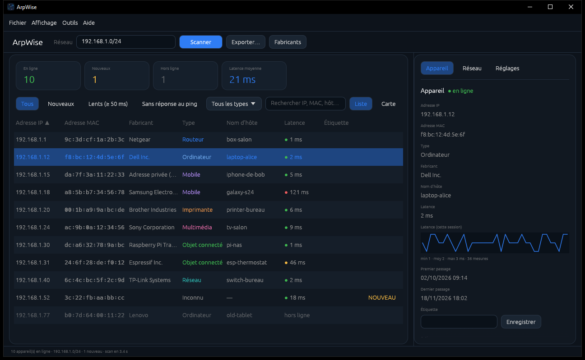
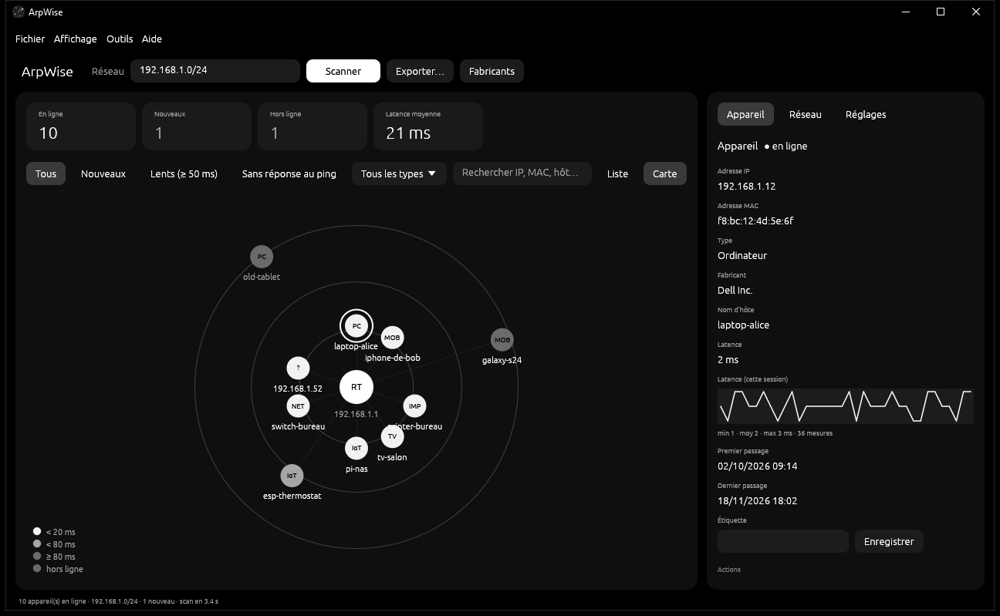
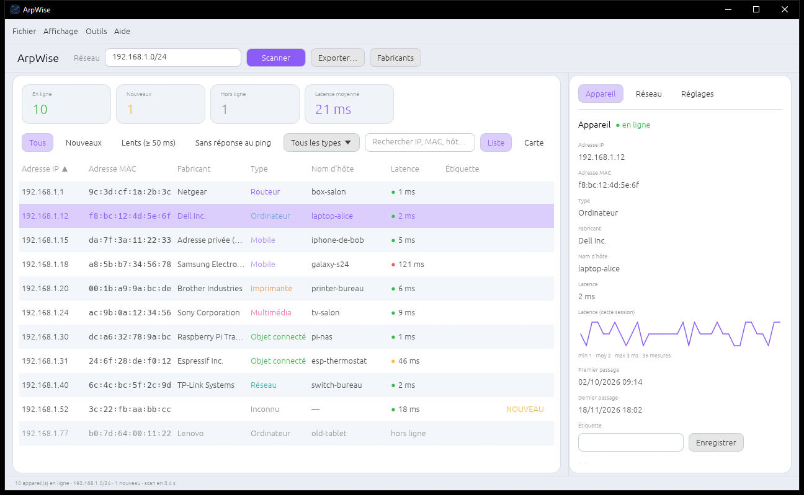

<p align="center">
  
</p>

<h1 align="center">ArpWise</h1>

<p align="center">
  <strong>See everything on your network, in one click.</strong><br>
  A fast, driver-free network scanner for Windows and Linux.
</p>

<p align="center">
  <a href="https://qoats.github.io/ArpWise/">Website</a> ·
  <a href="https://github.com/Qoats/ArpWise/releases/latest">Download</a> ·
  <a href="#command-line">Command line</a>
</p>

<p align="center">
  
</p>

ArpWise finds every device on your local network, tells you who made it and how fast it answers, and warns you when something new shows up. Written in Rust, one small executable. No Npcap, no Wireshark, no admin tools to install.

> Use ArpWise only on networks you own or are authorized to inspect.

## Screenshots

| Network map | Light theme |
|---|---|
|  |  |

*The screenshots use made-up devices (demo mode, see below), not a real network.*

## Why ArpWise

- **Nothing to install first.** It uses what your system already has: the native `SendARP` API on Windows, kernel neighbour discovery and `/proc/net/arp` on Linux.
- **Know who is on your network.** Every device with its IP, MAC address, hostname and manufacturer.
- **Spot intruders.** ArpWise remembers what it has seen, flags new devices, and keeps known ones that went offline.
- **Fast.** A full /24 scan takes seconds, and latency is measured for every device in parallel.
- **Two ways to use it.** A clean graphical app (dark or light) and a scriptable command line.

## Features

- IPv4 discovery with automatic local network detection
- Manufacturer lookup from the IEEE registry (downloaded once, never bundled)
- Latency of every device, shown as a dot from bright to dim
- Device history: first and last seen, new devices flagged, offline devices kept
- Automatic rescans (30 s to 15 min)
- Device type guess (router, network gear, computer, mobile, printer, media, IoT)
- Network map: the router in the middle, devices around it, placed by latency
- Latency graph per device, kept for the session
- Search, filters (new, slow, no ping reply, by type), sortable columns, custom labels
- Right-click actions: ping, traceroute, port scan, open in browser, Wake-on-LAN, copy IP or MAC
- Rounded interface in pure black and white, with menus (File, View, Tools, Help) and a dark or light theme, no lines and no shadows
- Many settings: zoom, compact rows, column visibility, ping timeout, "slow" threshold, auto-scan, scan at start, loading screen, always on top
- Manual tools: Wake-on-LAN by MAC address, ping / traceroute / port scan of any address
- Keyboard shortcuts: `F5` or `Ctrl+R` rescan, `Ctrl+F` search, `Ctrl+E` export
- Custom TCP port scan (`22,80,8000-8100`)
- Export to CSV or JSON
- Public IP and approximate location

## Download

Get the latest build from the [Releases page](https://github.com/Qoats/ArpWise/releases/latest).

| Platform | Files |
|---|---|
| Windows 64-bit, 32-bit, ARM64 | `.msi` installer or `.zip` |
| Linux x64, 32-bit (i386), ARM64 | `.deb` (Debian, Ubuntu…) |
| Linux x86_64, i686, aarch64 | `.rpm` (Fedora, openSUSE…) |

```bash
sudo apt install ./arpwise_*_amd64.deb      # Debian / Ubuntu
sudo dnf install ./arpwise-*.x86_64.rpm     # Fedora
```

The Windows installer adds a Start menu shortcut and puts the `arpwise` command on your `PATH`.

With a Rust toolchain, `cargo install arpwise` builds and installs both programs from [crates.io](https://crates.io/crates/arpwise).

On Windows, [Scoop](https://scoop.sh) can install it from this repository:

```powershell
scoop bucket add arpwise https://github.com/Qoats/ArpWise
scoop install arpwise
```

## Build from source

Requires a recent stable [Rust](https://rustup.rs) toolchain (and the MSVC build tools on Windows).

```bash
cargo build --release
```

You get two programs in `target/release/`:

| Program | What it is |
|---|---|
| `arpwise-gui` | The graphical app |
| `arpwise` | The command line |

## Command line

```bash
arpwise                                  # scan the detected local network
arpwise --network 192.168.1.0/24         # scan a specific private network
arpwise --ping --output devices.csv      # add latency, export (.csv or .json)
arpwise --update-vendors                 # download the manufacturer database
arpwise ports 192.168.1.10 --range 22,80,8000-8100
arpwise wake aa:bb:cc:dd:ee:ff
```

Devices are remembered between scans: new ones are flagged `NEW`, and known devices that do not answer are listed. Use `--no-history` to turn this off.

## Graphical app

Run `arpwise-gui`. The network is detected automatically. Click **Scanner**, select a device to see its details, or right-click it for quick actions. Use **Exporter…** to save the list and **Fabricants** to download the manufacturer database. Theme, zoom, automatic rescans, columns and more are in the **Réglages** tab.

**Demo mode.** Set `ARPWISE_DEMO=1` to open the app with made-up devices and no scan. Handy for screenshots.

## Where your data lives

`%APPDATA%\ArpWise` on Windows, `~/.config/ArpWise` on Linux: labels (`devices.json`), history (`history.json`), settings (`settings.json`) and manufacturers (`oui.csv`). Data from the earlier name, NetScanPy, is moved there automatically.

## Limits

ArpWise finds devices on the same local IPv4 subnet. ARP does not cross routers, so devices on other routed networks are out of reach. Only private networks of /16 or smaller are scanned.

## Publisher

ArpWise is made by **Qoats** — *software with a spine*. Contact: support@axim.ch

## License

GNU General Public License v3.0. See `LICENSE`.
